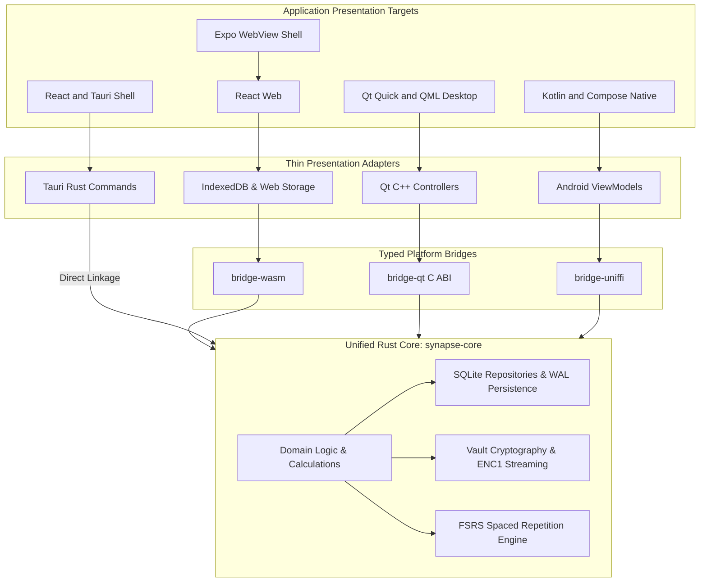

# Synapse

<div align="center">

**Personal Knowledge Management, Cognitive Study Station & Local Vault**

[](https://github.com/Vinicius-DEV1/synapse)
[](https://tauri.app/)
[](https://www.rust-lang.org/)
[](https://react.dev/)
[](https://www.typescriptlang.org/)
[](https://github.com/Vinicius-DEV1/synapse/actions/workflows/ci.yml)
[](./LICENSE)
[](https://www.docker.com/)

<p align="center">
  A local-first knowledge and study platform with React Web/Tauri, native Qt desktop, native Android, and an Expo WebView shell. Vault and encrypted-media protections exist, but at-rest encryption does not cover every data field; see the current security audit.
</p>

[🇧🇷 Leia a documentação em Português](./README.pt-BR.md) • [📚 Technical Documentation Hub](./docs/README.md) • [🤝 Contributing Guide](./CONTRIBUTING.md)

</div>

---

## 📑 Table of Contents

- [Vision & Core Philosophy](#-vision--core-philosophy)
- [Multi-Platform Support Matrix](#-multi-platform-support-matrix)
- [System Architecture Overview](#-system-architecture-overview)
- [Local Vault and Encryption Status](#-local-vault-and-encryption-status)
- [Proprietary ENC1 Video Streaming Architecture](#-proprietary-enc1-video-streaming-architecture)
- [Performance & Benchmarks](#-performance--benchmarks)
- [Core Feature Modules](#-core-feature-modules)
- [Getting Started](#-getting-started)
  - [Prerequisites](#prerequisites)
  - [Installation & Quick Start](#installation--quick-start)
  - [Running in Web Mode](#running-in-web-mode)
  - [Running in Desktop Mode (Tauri v2)](#running-in-desktop-mode-tauri-v2)
  - [Running with Docker (Self-Hosting)](#running-with-docker-self-hosting)
  - [Running the Mobile Companion](#running-the-mobile-companion)
- [Testing & Quality Assurance](#-testing--quality-assurance)
- [Security & Responsible Disclosure](#-security--responsible-disclosure)
- [Community & Support](#-community--support)
- [Author & License](#-author--license)

---

## 💡 Vision & Core Philosophy

Modern personal knowledge management applications frequently force a compromise between **convenience** and **privacy**, or between **speed** and **rich features**. Synapse is built around these goals; implementation coverage varies by app and module:

1. **Privacy and User-Controlled Vault**: Master Password and AES-256-GCM flows protect selected fields and managed media. Coverage is not repository-wide: some business data, metadata, and unmanaged assets remain plaintext at rest. The [native encryption audit](./docs/security/native-encryption-audit.md) lists verified coverage and open risks.
2. **Local-First & Offline Resilience**: The application reads and writes immediately to zero-latency local databases (**SQLite** on Desktop, **IndexedDB** on Web). You can work continuously without internet connectivity, and changes reconcile deterministically when reconnected.
3. **Responsive Interaction Design**: The web client uses caching and CSS compositing patterns where appropriate. Frame rates and input latency vary by device and app; no universal 60 FPS guarantee is claimed.
4. **Multiple Runtime Options**: React Web/Tauri remains the reference client; Qt and Kotlin/Compose are separate native clients, and the Expo shell hosts the web app. Native performance parity is measured separately and is not inferred from architecture alone.
5. **Cognitive Acceleration**: Integrated with the cutting-edge **FSRS** (Free Spaced Repetition Scheduler) algorithm and contextual **Google Gemini AI**, turning passive note-taking into an active learning powerhouse.

---

## 🌐 Multi-Platform Support Matrix

Synapse is architected with a unified codebase capable of running across desktop operating systems, standard web browsers, self-hosted containers, and mobile devices:

| Platform | Target Runtime | Persistence Engine | Native Capabilities | Status |
| :--- | :--- | :--- | :--- | :--- |
| **React Web** | React 19, Vite, browser | IndexedDB and configured sync adapters | Browser APIs and service worker | Active client; see build guide |
| **Tauri Desktop** | React frontend, Tauri v2, Rust | SQLite via Tauri backend | Native shell, filesystem, and Rust IPC | Active client; parity is tracked separately |
| **Native Qt Desktop** | Qt Quick/QML, C++17, Rust C-ABI | SQLite via shared Rust bridge | Native Qt UI and libmpv media integration | In development; see [parity matrix](./docs/native-desktop-parity.md) |
| **Native Android** | Kotlin, Jetpack Compose, UniFFI | Android app persistence and shared Rust capabilities | Native Android UI and Media3 integrations | In development; verify module status before relying on parity |
| **Android WebView Shell** | Expo, React Native, WebView | Hosts the React app | Safe areas, hardware back, haptics, native links | Wrapper app; not the native Compose client |
| **Docker / Self-Hosted** | Linux containers, Nginx | Serves the web build | Static hosting and configured cloud services | Deployment target; it does not imply full E2EE coverage |

---

## 🏛️ System Architecture Overview

Synapse is anchored by a **Unified Rust Core (`core/synapse-core`)** serving as the Single Source of Truth (SSOT) for domain logic, SQLite repositories, and encryption across all four application targets:



For the comprehensive architectural blueprint and runtime boundary specifications, consult [**`docs/architecture/overview.md`**](./docs/architecture/overview.md).

---

## 🔐 Local Vault and Encryption Status

The vault uses PBKDF2-HMAC-SHA256 to derive a master key and AES-256-GCM module-key envelopes. This protects selected content and supported media flows; it does not currently encrypt every SQLite field or prove that all plaintext residuals are removed.

```
User Master Password
        │
        ▼ (PBKDF2-HMAC-SHA256 • 600,000 Iterations + Salt)
Master Key (runtime memory; selected buffers are wiped on lock)
        │
        ├──▶ Decrypts Keychain ──▶ Module Keys (Notes, Vault, Finance, Files)
        │
        └──▶ AES-256-GCM (12-byte CSPRNG IV + 128-bit Auth Tag)
                 │
                 ├──▶ Selected local fields and managed assets [Protected]
                 └──▶ Other local records and metadata [Coverage varies]
```

### Cryptographic Standards

| Mechanism | Standard | Current status |
| :--- | :--- | :--- |
| **Key Derivation** | **PBKDF2-HMAC-SHA256** | 600,000 iterations. Existing local vaults use a fixed compatibility salt; a versioned salt migration remains open. |
| **Symmetric Cipher** | **AES-256-GCM** | Authenticated encryption uses fresh 96-bit (12-byte) nonces for protected content operations. |
| **Data Integrity** | **128-bit Auth Tag** | Instant rejection and detection of any tampering or ciphertext corruption (*wire format*: `iv:auth_tag:ciphertext`). |
| **Two-Tier Keychain** | **Master + Module Keys** | Current module-key envelopes are sealed by the Master Key; legacy key fallback behavior remains for older records. |
| **Memory Hygiene** | **Rust zeroization and lock cleanup** | Selected bridge buffers and key maps are wiped on lock. Complete zeroization of Qt strings, QML state, query buffers, WAL pages, and temporary files has not been proven. |
| **XSS Defense** | **DOMPurify & Content Security Policy** | Sanitization and CSP controls are client-specific; verify each route and embedded-content flow before claiming complete coverage. |

For verified native coverage and remaining gaps, read the [native encryption audit](./docs/security/native-encryption-audit.md). For vulnerability reporting, refer to [**`SECURITY.md`**](./SECURITY.md).

---

## 🎥 Proprietary ENC1 Video Streaming Architecture

Streaming large encrypted study videos requires bounded buffering and authenticated chunk reads.

The repository uses the custom **ENC1 Container Format** for supported media flows:

```
ENC1 File Format:
┌──────────────┬─────────────────────────┬─────────────────────────┬──────────────────────┐
│ Header (16B) │ Chunk 0 (IV + Cipher)   │ Chunk 1 (IV + Cipher)   │ Chunk N ...          │
│ Magic: "ENC1"│ 12B IV + AES-256-GCM    │ 12B IV + AES-256-GCM    │ 12B IV + AES-256-GCM │
│ Size: 8B     │ Tag: 16B • Data: ~1MB   │ Tag: 16B • Data: ~1MB   │ Tag: 16B • Data: ~1MB│
│ ChunkSz: 4B  │                         │                         │                      │
└──────────────┴─────────────────────────┴─────────────────────────┴──────────────────────┘
```

1. **Chunked Reads**: The 16-byte header stores the magic, original size, and supported 1 MiB chunk size. Each chunk carries its own nonce and authentication tag. The header itself is not authenticated.
2. **Native Readers**: Tauri and Qt have Rust-backed encrypted-media readers for their supported playback flows; buffering and behavior are platform-specific.
3. **Web Reader**: The React web client has its own encrypted media adapters. Verify its current path before assuming every browser or cloud provider uses the same range pipeline.

For complete byte calculation mathematics and container specifications, see [**`docs/protocols/enc1-streaming.md`**](./docs/protocols/enc1-streaming.md).

---

## ⚡ Performance & Benchmarks

Production bundle budgets and runtime latency optimizations (SQLite WAL 1-writer + 4-reader pool, 231 async Tauri commands, metadata-first notes loading, on-demand syntax highlighting, and granular React selectors) are enforced via `npm run check:budgets` and `npm run benchmark`. They do not measure the Qt or Android applications. Record the exact app target, commit, device, and benchmark command before making a performance claim. See [the performance & benchmarks guide](./docs/guides/performance-and-benchmarks.md).

---

## 📦 Core Feature Modules

### 1. 📝 Synapse Notes (Rich-Text Writing & Second Brain Engine)
- Full-featured TipTap v3 / ProseMirror block editor with rich text, code syntax highlighting (`lowlight`), dynamic LaTeX math formulas, tables, and task checklists.
- Dynamic hierarchical note tree with drag-and-drop reorganization (`@dnd-kit`) and bidirectional link graphing.
- Conflict-free real-time collaboration and multi-device synchronization powered by **Yjs CRDTs**.
- Visual version history with granular revision diffing (`htmldiff-js`).

### 2. 🔐 Vault (Credentials & Passwords)
- Password and credential vault using AES-256-GCM in its covered flows; consult the [encryption audit](./docs/security/native-encryption-audit.md) for scope and limitations.
- High-entropy password and passphrase generator with Shannon entropy evaluation.
- Breached credential verification via Have I Been Pwned (HIBP) k-Anonymity API integration.

### 3. 🧠 Anki & Spaced Repetition (FSRS Engine)
- Modern Free Spaced Repetition Scheduler (`ts-fsrs` v5) calculating cognitive memory stability and retrievability curves.
- Deck management with tag filtering, review scheduling, and performance retention analytics.
- Automated AI flashcard generation directly from lecture notes or video transcripts.

### 4. 🎯 Interactive Question Batteries & Focus Exam Solver
- Zen full-canvas distraction-free question solving environment designed for deep cognitive focus.
- Keyboard-first navigation (`A`, `B`, `C`, `D`, `Enter`, `Esc`) for zero-mouse fatigue.
- In-depth answer explanations, gabarito toggles, and instant feedback.

### 5. 📚 Digital Library & Document Reader (PDF & EPUB)
- Native-feeling PDF reader (`pdfjs-dist`) and EPUB book engine (`epubjs`).
- Dual-page view, reading progress tracking, colored margin highlights, and bookmarks.
- On-device text extraction from scanned documents and book captures using **Tesseract OCR**.

### 6. 🎬 Culture & Video Study Studio
- Encrypted ENC1 high-definition video player with subtitle synchronization (VTT/SRT).
- Integrated YouTube downloader and audio extractor (`yt-dlp` / `ffmpeg`).
- Interactive subtitle-based vocabulary acquisition with one-click flashcard extraction.

### 7. 🗣️ Language Immersion Practice (Gemini AI)
- Conversational foreign language simulation with speech and chat interfaces.
- **Core Memory Fact Extraction**: The AI dynamically recalls past user conversations, vocabulary struggles, and factual context.

### 8. 🎨 Infinite Diagrams & Whiteboard (Tldraw)
- Embedded infinite canvas powered by **Tldraw** for visual concept mapping, mind mapping, and architectural sketches.

### 9. ⏱️ Focus & Ambient Lo-Fi Studio
- Customizable Pomodoro and productivity countdown timers.
- Integrated ambient Lo-Fi audio player (rain, vinyl, synth waves) for immersive flow-state work.

### 10. 📁 Cloud Drive & Encrypted File Vault
- Personal cloud drive interface for arbitrary documents, images, and archives, encrypted before leaving the client.

### 11. 💰 Personal Finance Tracker
- Clean expense and income registry with categorical budgeting.
- Interactive financial charts and spending trends powered by **Recharts**.

### 12. 🏢 Multi-User Workspaces (Planned and Under Audit)
Workspace scoping, Firebase Authentication, RBAC, and migration are tracked as a proposal and security audit. Do not treat them as shipped capabilities or released collaborative E2EE. See the [multi-user workspace analysis](./docs/architecture/multiuser-workspace-analysis.md) and [action plan](./docs/architecture/multiuser-workspace-action-plan.md).

For full module details, domain models, and key assignments, explore [**`docs/modules/index.md`**](./docs/modules/index.md).

---

## 🚀 Getting Started

### Prerequisites

- **Node.js**: `18.0+` (Node 20 or 22 LTS recommended)
- **Package Manager**: `npm` (v9+)
- **Rust Toolchain**: `1.77.2+` (Required only for Desktop/Tauri development; install via [rustup.rs](https://rustup.rs/))
- **Docker**: Docker Engine 24+ & Docker Compose v2 (Optional, for containerized self-hosting)

---

Synapse ships four app targets: the React web app with its Tauri shell (`apps/web-react/`), a fully native Qt desktop app (`apps/desktop-qt/`), a native Kotlin/Compose Android app (`apps/mobile-android/`), and an Expo WebView shell (`apps/mobile-webview/`). See [the repository layout guide](./docs/architecture/repository-layout.md) for ownership and build commands. The current Qt parity gaps are listed in the [native desktop parity matrix](./docs/native-desktop-parity.md).

### Installation & Quick Start

1. **Clone the repository**:
   ```bash
   git clone https://github.com/Vinicius-DEV1/synapse.git
   cd synapse
   ```

2. **Install dependencies**:
   ```bash
   npm install
   ```

3. **Configure environment variables (Optional)**:
   ```bash
   cp apps/web-react/.env.example apps/web-react/.env
   ```
   *Cloud, AI, and online metadata integrations require configuration and connectivity. Local workflows may remain available offline, depending on the app and feature.*

---

### Running in Web Mode

Launches the web client with instant Vite Hot Module Replacement (HMR):
```bash
npm run dev
```
Navigate to `http://localhost:35174` in your browser.

To produce an optimized production web build:
```bash
npm run build:web
```
The output will be placed in the `apps/web-react/dist-web` directory.

---

### Running in Desktop Mode (Tauri v2)

Make sure you have installed the Rust toolchain and platform build dependencies (e.g. `build-essential`, `libwebkit2gtk-4.1-dev` on Linux).

```bash
# Run in desktop development mode with live reload
npm run tauri -- dev

# Compile an optimized native desktop binary
npm run tauri -- build
```

Installers are generated in `target/release/bundle/` (`.deb`, `.AppImage`, `.msi`, `.exe`, `.dmg`).

---

### Running with Docker (Self-Hosting)

Synapse includes a multi-stage `Dockerfile` and `docker-compose.yml` for self-hosting on homelabs, VPS, or NAS:

```bash
# Build and run the production container in the background
docker compose up -d --build

# View container logs
docker compose logs -f

# Stop the container
docker compose down
```

Once running, access Synapse Web at `http://localhost:8080`. For advanced configuration, consult [**`docs/guides/docker-self-hosting.md`**](./docs/guides/docker-self-hosting.md).

---

### Running the Mobile Companion

Synapse includes an Expo-powered mobile companion shell in `apps/mobile-webview`:

```bash
cd apps/mobile-webview
npm install

# Start Expo development server
npm run start

# Launch on Android Emulator or connected device
npm run android
```

---

### Running the Native Apps

Build the Qt desktop app with CMake:

```bash
cmake -S apps/desktop-qt -B apps/desktop-qt/build -DCMAKE_BUILD_TYPE=Release
cmake --build apps/desktop-qt/build --config Release
```

Build the Kotlin/Compose Android app with Gradle:

```bash
cd apps/mobile-android
./gradlew assembleDebug
```

## 🧪 Testing & Quality Assurance

Use the commands below for current checks. Test counts and results vary by checkout; this README does not claim a fixed repository-wide pass total or coverage percentage.

```bash
# Run fast targeted tests (sub-second feedback)
npm run test -- src/services/crypto.test.ts

# Run the configured web domain, hook, and persistence suite
npm run test:unit

# Generate comprehensive test coverage report (v8 engine)
npm run test:coverage

# Run tests related to modified files
npm run test:related -- src/services/crypto.ts

# Verify strict TypeScript type integrity without emitting code
npm run typecheck

# Lint code style and best practices
npm run lint
```

For complete risk mapping, failure simulations, and testing strategy, consult [**`docs/guides/testing-and-quality.md`**](./docs/guides/testing-and-quality.md) and [**`CONTRIBUTING.md`**](./CONTRIBUTING.md).

---

## 🛡️ Security & Responsible Disclosure

Security vulnerabilities and cryptographic concerns should be reported through our private advisory channels. See [**`SECURITY.md`**](./SECURITY.md) for full disclosure policies and response SLAs.

---

## 💬 Community & Support

- **Bug Reports & Issues**: [GitHub Issues](https://github.com/Vinicius-DEV1/synapse/issues)
- **Feature Requests & Ideas**: [GitHub Discussions](https://github.com/Vinicius-DEV1/synapse/discussions)
- **Release History**: [CHANGELOG.md](./CHANGELOG.md)

---

## 👤 Author & License

Developed and engineered with precision by **Vinicius Calado** ([@Vinicius-DEV1](https://github.com/Vinicius-DEV1)).

Licensed under the **Business Source License 1.1 (BSL 1.1)**.
Free for all non-commercial personal knowledge management, study, research, and non-commercial self-hosted personal use. Commercial deployment, SaaS resale, and proprietary closed-source redistribution are strictly prohibited without an explicit commercial license. Converts to **GNU General Public License v3.0 or later (GPL-3.0-or-later)** on 2030-01-01.

See the [**`LICENSE`**](./LICENSE) file for complete terms and conditions.

Copyright (c) 2026 Vinicius Calado ([@Vinicius-DEV1](https://github.com/Vinicius-DEV1)). All rights reserved.
