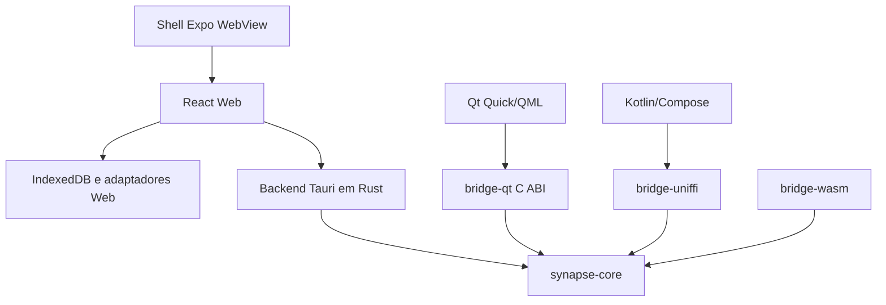

# Synapse

<div align="center">

**Gestão Pessoal do Conhecimento, Estação de Aprendizagem Cognitiva & Cofre Local**

[](https://github.com/Vinicius-DEV1/synapse)
[](https://tauri.app/)
[](https://www.rust-lang.org/)
[](https://react.dev/)
[](https://www.typescriptlang.org/)
[](https://github.com/Vinicius-DEV1/synapse/actions/workflows/ci.yml)
[](./LICENSE)
[](https://www.docker.com/)

<p align="center">
  Uma plataforma local-first de conhecimento e estudo com React Web/Tauri, desktop Qt nativo, Android nativo e um shell Expo WebView. O cofre e a mídia criptografada protegem fluxos selecionados; a criptografia em repouso ainda não cobre todos os campos. Consulte a auditoria de segurança atual.
</p>

[🇺🇸 Read in English](./README.md) • [📚 Hub de Documentação Técnica](./docs/README.md) • [🤝 Guia de Contribuição](./CONTRIBUTING.md)

</div>

---

## 📑 Índice

- [Visão & Filosofia Central](#-visão--filosofia-central)
- [Matriz de Suporte Multiplataforma](#-matriz-de-suporte-multiplataforma)
- [Visão Geral da Arquitetura](#-visão-geral-da-arquitetura)
- [Cofre Local e Estado da Criptografia](#-cofre-local-e-estado-da-criptografia)
- [Streaming de Vídeo Criptografado ENC1](#-streaming-de-vídeo-criptografado-enc1)
- [Desempenho & Benchmarks](#-desempenho--benchmarks)
- [Módulos do Sistema](#-módulos-do-sistema)
- [Começando](#-começando)
  - [Pré-requisitos](#pré-requisitos)
  - [Instalação & Início Rápido](#instalação--início-rápido)
  - [Executando em Modo Web](#executando-em-modo-web)
  - [Executando em Modo Desktop (Tauri v2)](#executando-em-modo-desktop-tauri-v2)
  - [Executando com Docker (Self-Hosting)](#executando-com-docker-self-hosting)
  - [Executando o Mobile Companion](#executando-o-mobile-companion)
- [Testes & Garantia de Qualidade](#-testes--garantia-de-qualidade)
- [Segurança & Divulgação Responsável](#-segurança--divulgação-responsável)
- [Comunidade & Suporte](#-comunidade--suporte)
- [Autor & Licença](#-autor--licença)

---

## 💡 Visão & Filosofia Central

Aplicativos modernos de gestão de conhecimento pessoal frequentemente forçam uma escolha entre **conveniência** e **privacidade**, ou entre **velocidade** e **recursos ricos**. O Synapse é construído em torno desses objetivos; a implementação varia por aplicativo e módulo:

1. **Privacidade e Cofre sob Controle do Usuário**: Fluxos de senha-mestre e AES-256-GCM protegem campos e mídias selecionados. A cobertura não é geral: alguns dados de negócio, metadados e arquivos fora das pastas gerenciadas permanecem em texto puro em repouso. A [auditoria de criptografia](./docs/security/native-encryption-audit.md) lista cobertura e riscos abertos.
2. **Resiliência Local-First & Offline**: A aplicação lê e escreve imediatamente em bancos locais de latência zero (**SQLite** no Desktop, **IndexedDB** na Web). Você pode trabalhar continuamente sem conexão à internet, e as alterações se reconciliam deterministicamente ao reconectar.
3. **Interações Responsivas**: O cliente Web usa cache e composição CSS quando apropriado. Taxa de quadros e latência variam por dispositivo e aplicativo; não há garantia universal de 60 FPS.
4. **Opções de Runtime**: React Web/Tauri continua sendo a referência visual e funcional. Qt e Kotlin/Compose são clientes nativos separados; o shell Expo hospeda a versão web. A paridade de desempenho nativo é medida separadamente, não presumida pela arquitetura.
5. **Aceleração Cognitiva**: Integrado ao algoritmo de ponta **FSRS** (Free Spaced Repetition Scheduler) e ao contexto de IA do **Google Gemini**, transformando anotações passivas em um motor ativo de aprendizagem.

---

## 🌐 Matriz de Suporte Multiplataforma

O Synapse foi arquitetado com uma base de código unificada capaz de rodar em sistemas operacionais desktop, navegadores web modernos, contêineres e dispositivos móveis:

| Plataforma | Runtime Alvo | Mecanismo de Persistência | Recursos Nativos | Status |
| :--- | :--- | :--- | :--- | :--- |
| **React Web** | React 19, Vite, navegador | IndexedDB e adaptadores de sync configurados | APIs do navegador e service worker | Cliente ativo; consulte o guia de build |
| **Desktop Tauri** | Frontend React, Tauri v2, Rust | SQLite pelo backend Tauri | Shell nativo, sistema de arquivos e Rust IPC | Cliente ativo; paridade acompanhada separadamente |
| **Desktop Qt Nativo** | Qt Quick/QML, C++17, Rust C-ABI | SQLite via ponte Rust compartilhada | UI Qt nativa e integração de mídia libmpv | Em desenvolvimento; veja a [matriz de paridade](./docs/native-desktop-parity.md) |
| **Android Nativo** | Kotlin, Jetpack Compose, UniFFI | Persistência do app Android e recursos Rust compartilhados | UI Android nativa e integrações Media3 | Em desenvolvimento; verifique a cobertura de cada módulo |
| **Shell Android WebView** | Expo, React Native, WebView | Hospeda o app React | Safe areas, botão voltar, haptics e links nativos | Shell; não substitui o cliente Compose nativo |
| **Docker / Self-Hosted** | Contêiner Linux, Nginx | Serve o build web | Hospedagem estática e serviços de nuvem configurados | Alvo de deploy; não comprova E2EE total |

---

## 🏛️ Visão Geral da Arquitetura

O Synapse contém quatro alvos de aplicativo com apresentações e adaptadores de armazenamento específicos. Recursos Rust são compartilhados onde os contratos entre plataformas já foram implementados:



Para o blueprint arquitetural completo, consulte [**`docs/architecture/overview.md`**](./docs/architecture/overview.md).

---

## 🔐 Cofre Local e Estado da Criptografia

O cofre usa PBKDF2-HMAC-SHA256 para derivar uma chave-mestre e AES-256-GCM para envelopes de chaves de módulo. Isso protege campos e fluxos de mídia selecionados; hoje não criptografa todas as colunas SQLite nem comprova a remoção de todos os resíduos em texto puro.

```
Senha-Mestre do Usuário
        │
        ▼ (PBKDF2-HMAC-SHA256 • 600.000 Iterações + Salt)
Chave-Mestre (em memória durante a sessão; alguns buffers são limpos ao bloquear)
        │
        ├──▶ Descriptografa o Keychain ──▶ Chaves de Módulo (Notas, Cofre, Finanças, Arquivos)
        │
        └──▶ AES-256-GCM (IV CSPRNG de 12 bytes + Tag de Autenticação de 128 bits)
                 │
                 ├──▶ Campos e mídias gerenciados selecionados [Protegidos]
                 └──▶ Outros registros e metadados locais [Cobertura variável]
```

### Padrões Criptográficos

| Mecanismo | Padrão | Garantia de Segurança |
| :--- | :--- | :--- |
| **Derivação de Chave** | **PBKDF2-HMAC-SHA256** | 600.000 iterações. Cofres locais existentes usam um salt fixo de compatibilidade; a migração versionada para salt individual permanece aberta. |
| **Cifra Simétrica** | **AES-256-GCM** | Criptografia autenticada usa nonces novos de 96 bits (12 bytes) nos fluxos protegidos. |
| **Integridade dos Dados** | **Tag de Autenticação 128-bit** | Detecção e rejeição imediata de adulterações (*formato*: `iv:auth_tag:ciphertext`). |
| **Keychain Two-Tier** | **Chave-Mestre + Chaves de Módulo** | Envelopes de chaves de módulo selados pela chave-mestre; registros antigos podem usar fallback de chave. |
| **Higiene de Memória** | **Zeroização parcial** | Buffers e mapas selecionados são limpos ao bloquear. A limpeza completa de strings Qt/QML, buffers de query, páginas WAL e temporários ainda não foi comprovada. |
| **Defesa contra XSS** | **DOMPurify & CSP** | As políticas variam por cliente e rota; consulte a auditoria de segurança antes de afirmar cobertura integral. |

Para a cobertura verificada e os gaps abertos, consulte a [auditoria de criptografia nativa](./docs/security/native-encryption-audit.md).

---

## 🎥 Streaming de Vídeo Criptografado ENC1

O streaming de arquivos grandes exige leitura por blocos e buffering limitado.

Os fluxos de mídia suportados usam o formato **ENC1**:

```
Formato do Arquivo ENC1:
┌──────────────┬─────────────────────────┬─────────────────────────┬──────────────────────┐
│ Header (16B) │ Bloco 0 (IV + Cifra)    │ Bloco 1 (IV + Cifra)    │ Bloco N ...          │
│ Magic: "ENC1"│ 12B IV + AES-256-GCM    │ 12B IV + AES-256-GCM    │ 12B IV + AES-256-GCM │
│ Tamanho: 8B  │ Tag: 16B • Dados: ~1MB  │ Tag: 16B • Dados: ~1MB  │ Tag: 16B • Dados: ~1MB│
│ TamBloco: 4B │                         │                         │                      │
└──────────────┴─────────────────────────┴─────────────────────────┴──────────────────────┘
```

1. **Leitura em blocos**: O cabeçalho de 16 bytes armazena magic, tamanho original e chunk size de 1 MiB. Cada bloco tem nonce e tag próprios; o cabeçalho não é autenticado.
2. **Leitores nativos**: Tauri e Qt têm leitores Rust-backed nos fluxos de mídia suportados; buffering e comportamento variam por plataforma.
3. **Leitor Web**: O cliente React tem adaptadores próprios para mídia criptografada. Verifique o fluxo atual antes de presumir que todos os navegadores e provedores usam o mesmo pipeline de ranges.

Para a documentação completa do protocolo, consulte [**`docs/protocols/enc1-streaming.md`**](./docs/protocols/enc1-streaming.md).

---

## ⚡ Desempenho & Benchmarks

Não há medições atuais publicadas aqui. Os comandos configurados de benchmark e limite de bundle Web são `npm run benchmark` e `npm run check:budgets`; eles não medem os aplicativos Qt ou Android. Registre alvo, commit, dispositivo e comando usado antes de divulgar uma alegação de desempenho. Consulte [**`docs/DESEMPENHO.md`**](./docs/DESEMPENHO.md).

---

## 📦 Módulos do Sistema

### 1. 📝 Synapse Notes (Escrita em Texto Rico & Segundo Cérebro)
- Editor em blocos baseado em TipTap v3 / ProseMirror com syntax highlighting (`lowlight`), fórmulas LaTeX dinâmicas, tabelas e listas de tarefas.
- Árvore de notas com reordenação por arrastar e soltar (`@dnd-kit`) e grafo bidirecional de links.

### 2. 🔐 Cofre Local & Gerador de Credenciais
- Cofre de credenciais com gerador criptográfico de senhas e medidor de entropia. A cobertura de criptografia local varia; consulte a [auditoria de criptografia](./docs/security/native-encryption-audit.md).
- Verificação de senhas comprometidas via Have I Been Pwned k-anonymity: o fluxo envia um prefixo do hash, não a senha em si.

### 3. 🧠 Cartões Mnemônicos FSRS & Flashcards Anki
- Motor de repetição espaçada de ponta baseado no algoritmo **FSRS** (Free Spaced Repetition Scheduler).
- Geração inteligente de flashcards por IA a partir de notas, PDFs e transcrições de vídeo.

### 4. 📚 Leitor Acadêmico de PDF & EPUB
- Visualizadores integrados para PDF (`pdfjs-dist`) e EPUB (`epubjs`) com marcadores, destaques coloridos e anotações.
- OCR integrado no navegador via **Tesseract.js** para capturar trechos de imagens e digitalizações.

### 5. 🎬 Cinema Studio & Player Educacional de Vídeo
- Reprodução fluida de mídias criptografadas em ENC1, com controle de velocidade, anotações sincronizadas no tempo e legendas.

### 6. 📅 Calendário de Estudos & Linha do Tempo
- Visão mensal e semanal integrada com tarefas, lembretes de revisões FSRS e eventos recorrentes.

### 7. 🤖 Estúdio de Conversação & Prática Oral (Gemini AI)
- Simulação conversacional por voz e texto com extração de memória persistente entre sessões.

### 8. 🎨 Quadro Branco Infinito & Diagramas (Tldraw)
- Tela infinita para mapas mentais, esboços arquiteturais e pensamento visual.

### 9. ⏱️ Estúdio de Foco & Áudio Lo-Fi
- Temporizador Pomodoro personalizável e gerador de paisagens sonoras relaxantes (chuva, vinil, synthwave).

### 10. 📁 Nuvem & Arquivos Criptografados
- Armazenamento em nuvem pessoal com criptografia local prévia e transferências resumíveis no Google Drive (OAuth2 PKCE).

### 11. 💰 Gestão Financeira Pessoal
- Controle de receitas, despesas e orçamentos com gráficos interativos (`recharts`).

### 12. Workspaces Multiusuário (Plano de Evolução)
O escopo por workspace, Firebase Authentication, RBAC e migração de dados estão em planejamento e auditoria. Não os trate como funcionalidades lançadas nem como E2EE colaborativa disponível. Consulte a [análise de workspaces multiusuário](./docs/architecture/multiuser-workspace-analysis.md) e o [plano de ação](./docs/architecture/multiuser-workspace-action-plan.md).

---

## 🚀 Começando

### Pré-requisitos

- **Node.js**: `18.0+` (Node 20 ou 22 LTS recomendado)
- **Gerenciador de Pacotes**: `npm` (v9+)
- **Toolchain Rust**: `1.77.2+` (Necessário apenas para desenvolvimento Desktop/Tauri; instale via [rustup.rs](https://rustup.rs/))
- **Docker**: Docker Engine 24+ & Docker Compose v2 (Opcional, para auto-hospedagem)

---

O Synapse tem quatro alvos de aplicativo: a versão web React com seu shell Tauri (`apps/web-react/`), o desktop Qt totalmente nativo (`apps/desktop-qt/`), o Android nativo em Kotlin/Compose (`apps/mobile-android/`) e o shell Expo com WebView (`apps/mobile-webview/`). Consulte [o guia da estrutura do repositório](./docs/architecture/repository-layout.md) para conhecer a organização e os comandos de build. As lacunas atuais de paridade no Qt estão listadas na [matriz de paridade do desktop nativo](./docs/native-desktop-parity.md).

### Instalação & Início Rápido

1. **Clone o repositório**:
   ```bash
   git clone https://github.com/Vinicius-DEV1/synapse.git
   cd synapse
   ```

2. **Instale as dependências**:
   ```bash
   npm install
   ```

3. **Configure as variáveis de ambiente (Opcional)**:
   ```bash
   cp apps/web-react/.env.example apps/web-react/.env
   ```
   *Integrações de nuvem, IA e metadados online exigem configuração e conexão. Fluxos locais podem continuar disponíveis offline, dependendo do aplicativo e do recurso.*

---

### Executando em Modo Web

Inicia o cliente web com Hot Module Replacement (HMR) instantâneo do Vite:
```bash
npm run dev
```
Acesse `http://localhost:35174` no navegador.

Para gerar uma compilação de produção web otimizada:
```bash
npm run build:web
```
Os arquivos gerados estarão no diretório `apps/web-react/dist-web`.

---

### Executando em Modo Desktop (Tauri v2)

Certifique-se de ter o Rust e as dependências do sistema operacional instaladas:
```bash
# Executar em modo desenvolvimento desktop com hot reload
npm run tauri -- dev

# Compilar o binário de produção otimizado
npm run tauri -- build
```
Os instaladores serão gerados em `target/release/bundle/` (`.deb`, `.AppImage`, `.msi`, `.exe`, `.dmg`).

---

### Executando com Docker (Self-Hosting)

O Synapse inclui um `Dockerfile` multi-stage e `docker-compose.yml`:
```bash
# Compilar e iniciar em segundo plano
docker compose up -d --build

# Visualizar logs
docker compose logs -f

# Parar os serviços
docker compose down
```
Acesse o Synapse Web em `http://localhost:8080`. Para detalhes, consulte [**`docs/guides/docker-self-hosting.md`**](./docs/guides/docker-self-hosting.md).

---

### Executando o Mobile Companion

O Synapse inclui o shell móvel baseado em Expo em `apps/mobile-webview`:
```bash
cd apps/mobile-webview
npm install

# Iniciar servidor Expo
npm run start

# Executar no Emulador Android ou dispositivo conectado
npm run android
```

---

### Executando os Aplicativos Nativos

Compile o desktop Qt com CMake:

```bash
cmake -S apps/desktop-qt -B apps/desktop-qt/build -DCMAKE_BUILD_TYPE=Release
cmake --build apps/desktop-qt/build --config Release
```

Compile o aplicativo Kotlin/Compose com Gradle:

```bash
cd apps/mobile-android
./gradlew assembleDebug
```

## 🧪 Testes & Garantia de Qualidade

Use os comandos abaixo para as verificações atuais. Quantidade de testes e resultados variam entre checkouts; este README não declara um total ou percentual fixo de aprovação para o repositório.

```bash
# Executar testes direcionados ultrarrápidos (Vitest)
npm run test -- src/services/crypto.test.ts

# Executar a suíte configurada de serviços, hooks e persistência Web
npm run test:unit

# Gerar relatório detalhado de cobertura (motor v8)
npm run test:coverage

# Testar arquivos modificados
npm run test:related -- src/services/crypto.ts

# Verificar integridade de tipagem TypeScript sem emitir código
npm run typecheck

# Analisar código e boas práticas
npm run lint
```

Para o mapa completo de riscos, simulação de falhas e metodologia, consulte [**`docs/TESTES.md`**](./docs/TESTES.md) e [**`CONTRIBUTING.md`**](./CONTRIBUTING.md).

---

## 🛡️ Segurança & Divulgação Responsável

Vulnerabilidades de segurança e preocupações criptográficas devem ser reportadas através dos nossos canais privados de assessoria. Consulte o [**`SECURITY.md`**](./SECURITY.md) para detalhes da política de divulgação.

---

## 💬 Comunidade & Suporte

- **Relatórios de Bugs & Problemas**: [GitHub Issues](https://github.com/Vinicius-DEV1/synapse/issues)
- **Sugestões & Discussões**: [GitHub Discussions](https://github.com/Vinicius-DEV1/synapse/discussions)
- **Histórico de Lançamentos**: [CHANGELOG.md](./CHANGELOG.md)

---

## 👤 Autor & Licença

Desenvolvido e arquitetado por **Vinicius Calado** ([@Vinicius-DEV1](https://github.com/Vinicius-DEV1)).

Licenciado sob a **Business Source License 1.1 (BSL 1.1)**.  
Livre e gratuito para todo uso pessoal não-comercial, estudos, pesquisa acadêmica e instâncias pessoais auto-hospedadas. Uso comercial, revenda como serviço (SaaS) ou redistribuição em código fechado são estritamente proibidos sem licença comercial do autor. Converte-se na licença **GNU General Public License v3.0 ou posterior (GPL-3.0-or-later)** em 01/01/2030.

Consulte o arquivo [**`LICENSE`**](./LICENSE) para ver o texto integral.

Copyright (c) 2026 Vinicius Calado ([@Vinicius-DEV1](https://github.com/Vinicius-DEV1)). Todos os direitos reservados.
