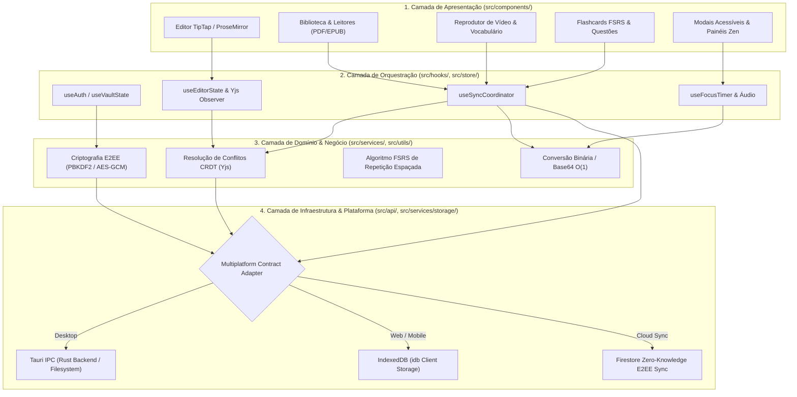

# Arquitetura do Sistema Synapse

O **Synapse** é uma aplicação híbrida de alto desempenho projetada para Desktop (Tauri v2 / Rust), Web Browser (PWA) e Mobile WebView (Android), construída sobre quatro pilares fundamentais: **privacidade absoluta (E2EE Zero-Knowledge)**, **sincronização resiliente offline-first**, **alta fidelidade funcional e visual**, e **separação estrita de responsabilidades**.

---

## 1. Visão Geral das 4 Camadas Arquiteturais

A base de código segue um modelo estrito de quatro camadas desacopladas:

---

## 2. Decisões Técnicas Principais e Justificativas

### 2.1. Criptografia E2EE de Dois Níveis (Two-Tier Keychain)
- **Decisão**: Todos os dados do usuário sincronizados com a nuvem são cifrados localmente antes da transmissão utilizando uma arquitetura de chaves em dois níveis:
  1. **Master Key**: Derivada a partir da Master Password do usuário via **PBKDF2** (com 600.000 iterações de SHA-256 e sal criptográfico único por conta).
  2. **Vault Key & Module Keys**: Chaves simétricas **AES-256-GCM** geradas aleatoriamente por módulo (Notas, Finanças, Biblioteca, Vídeo, etc.) e empacotadas (wrapped) pela Master Key.
- **Motivo**: Garante princípio de **Zero-Knowledge** absoluto. Nem o Firebase/Google nem administradores do servidor possuem acesso às chaves ou aos dados decifrados. Além disso, a troca da senha mestre (re-keying) não exige re-criptografar terabytes de arquivos locais, apenas re-empacotar as Module Keys.

### 2.2. Sincronização Híbrida: CRDT (Yjs) + Last-Write-Wins Seguro
- **Decisão**: Utilização de **Yjs / y-prosemirror** para documentos colaborativos ricos e árvores de notas, combinada com carimbos de tempo criptograficamente autenticados (`updated_at`, `deleted_at`) para metadados e registros estruturados.
- **Motivo**: Edições offline concorrentes entre desktop e mobile convergem deterministicamente sem perda de dados, mantendo total integridade tipográfica e estrutural sem necessidade de um servidor central de coordenação.

### 2.3. Contrato Unificado de Plataforma (`window.api`)
- **Decisão**: Toda interação com storage, arquivos, diálogos nativos e processos do sistema é exposta através da interface `ICadernoAPI` (`src/api/types.ts`). A aplicação React nunca importa módulos do `@tauri-apps/plugin-*` diretamente nos componentes.
- **Motivo**: Respeita o Princípio de Inversão de Dependência (DIP) e Substituição de Liskov (LSP). O mesmo código frontend roda de forma idêntica no Desktop (Tauri), no Navegador Web (IndexedDB) e no Mobile WebView, permitindo testes de unidade ultrarrápidos em Node/jsdom sem mockar subsistemas nativos do SO.

### 2.4. Otimização de Serialização Binária Zero-Copy
- **Decisão**: Implementação de tabelas de lookup pré-alocadas de 256 entradas (`HEX_TABLE`) e conversão Base64 por blocos de 16 KB (`uint8ArrayToBase64`) em `src/utils/binary.ts`.
- **Motivo**: Elimina o garbage collection churn gerado por arrays intermediários do JavaScript e previne falhas de estouro de pilha (`Maximum call stack size exceeded` gerado pelo uso inadequado de `String.fromCharCode.apply`). Reduziu a latência de compressão de 55 ms para 1.7 ms (ganho de 32x).

### 2.5. Design Minimalista Imersivo (Zen Canvas)
- **Decisão**: Experiências de foco profundo (leitura de livros, resolução de baterias de questões, reprodução de vídeos e inspeção de histórico) utilizam telas completas integradas (`fixed inset-0 bg-zinc-950`) em vez de modais flutuantes claustrofóbicos.
- **Motivo**: Elimina fadiga cognitiva e visual, garantindo ergonomia de leitura prolongada com atalhos de teclado de primeira classe (`Esc`, `Enter`, `A-D`).
