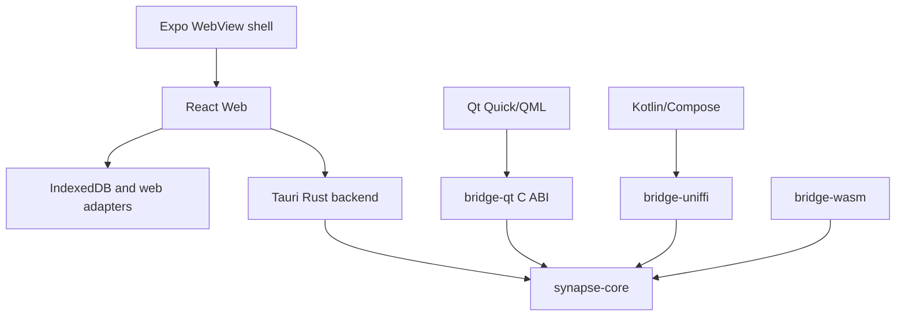

# Synapse System Architecture

**Status:** Current architectural overview. Feature and security completion are tracked separately in the [native desktop parity matrix](../native-desktop-parity.md) and [native encryption audit](../security/native-encryption-audit.md).

Synapse is a multi-app knowledge and study platform. The React client is the functional and visual reference for native parity work. The repository also contains a Tauri shell, a native Qt desktop client, a native Kotlin/Compose Android client, and an Expo WebView shell. Their modules are not all at equal parity.

## 1. Application Targets

| Target | Source | Runtime and ownership |
| --- | --- | --- |
| React Web and Tauri | `apps/web-react/` | React 19, TypeScript, Vite, browser adapters, and the Tauri v2 Rust backend |
| Native Qt Desktop | `apps/desktop-qt/` | Qt Quick/QML, C++17 controllers, SQLite access through the Qt Rust bridge, and libmpv media rendering |
| Native Android | `apps/mobile-android/` | Kotlin, Jetpack Compose, Android-specific UI and services, with shared Rust capabilities exposed through UniFFI |
| Android WebView Shell | `apps/mobile-webview/` | Expo/React Native host that loads the React web app and provides Android shell capabilities |

The root npm workspace delegates to `apps/web-react/`. The Expo shell and native Android app use their own build systems. Shared Rust code and its bindings live in `core/synapse-core/` and `bridges/`. See [repository layout](./repository-layout.md) and [module structure](./module-structure.md) for ownership details.

## 2. Shared-Code Boundaries

The shared Rust crate currently contains database migrations and connection code, cryptographic primitives and ENC1 streaming, FSRS helpers, and video-reading support. Product modules still have platform-specific orchestration and persistence code. Do not assume every business rule or module CRUD path has been moved into Rust.

### React and Tauri

React presentation, state orchestration, domain services, and platform adapters remain separated under `apps/web-react/src/`. The Tauri Rust backend owns native commands and uses its database and platform adapters. Shared Rust utilities are called through `core/synapse-core/` where integrated.

### Qt Desktop

QML owns native presentation. Feature controllers under `apps/desktop-qt/src/controllers/<module>/` coordinate SQLite access, crypto operations, and platform behavior. The Rust C ABI is exposed by `bridges/bridge-qt/`. Some controller responsibilities remain in C++; do not describe the entire Qt application as Rust-core-driven.

### Android

The Compose application owns Android presentation and lifecycle behavior. The UniFFI bridge exposes shared Rust capabilities. Native Android feature coverage must be checked against its own implementation and build/test evidence; the Qt parity matrix does not certify Android parity.

### WebView Shell

The Expo app is a host shell, not a duplicate product implementation. Keep safe-area, back-button, link policy, and native capability integration there. Product module UI remains in React or the fully native Android app.

## 3. Data and Synchronization

- React Web uses browser storage and configured cloud adapters.
- Tauri and Qt use SQLite through their respective native persistence paths.
- Android has a separate native app and persistence boundary; shared schema or behavior must be verified before claiming cross-client interchangeability.
- React note collaboration uses Yjs in the flows that implement it. This does not establish Yjs collaboration parity in Qt or Compose.
- Sync, sharing, workspace, and cloud behavior remain client-specific unless a shared contract is documented and tested.

## 4. Cryptographic Coverage

The repository implements PBKDF2-HMAC-SHA256 derivation, AES-GCM key envelopes, selected field protection, and encrypted media flows. These mechanisms do **not** mean every SQLite entity, metadata field, external asset, or in-memory copy is encrypted or scrubbed.

The Qt setup migrates supported note, revision, diagram, and vault content plus referenced media in managed folders. Sensitive business records in several modules remain plaintext at rest; files outside managed folders are not migrated; and some metadata remains visible. See the [native encryption audit](../security/native-encryption-audit.md) before publishing E2EE or zero-residual claims.

## 5. Feature Parity and Performance

A screen existing in Qt or Compose does not prove functional parity. The [native desktop parity matrix](../native-desktop-parity.md) records the Qt gaps and acceptance gates. Compare the original React flow for controls, keyboard behavior, loading and error states, data migration, and visual geometry.

Performance is also platform-specific. Historical web bundle or browser benchmarks are not evidence of native Qt or Android speed. Re-run measured workloads on the target app before making performance claims.

## 6. Build and Verification

Use the [setup and build guide](../guides/setup-and-build.md) for current prerequisites and commands. Use the app-level `AGENTS.md` files for local ownership rules. Current documentation sources and historical reports are indexed in [documentation status](../documentation-status.md).
