# ⚡ Performance Architecture & Benchmarking Guide

**Status:** Active Reference  
**Last Reviewed:** 2026-11-21

This guide documents the performance engineering architecture, bundle and runtime budgets, SQLite/IndexedDB concurrency models, and reproducible benchmark commands for the **Synapse** platform (`apps/web-react/` and `core/synapse-core/`).

---

## 1. Performance Architecture Overview

Synapse is engineered for zero-stutter responsiveness across large knowledge vaults (5,000+ pages, flashcards, and media items) while preserving End-to-End Encryption (E2EE) and Yjs CRDT integrity.

```mermaid
flowchart LR
  subgraph UI["React 19 Presentation & Compositor"]
    Sel["Granular Store Selectors (useStoreSelector)"]
    Lazy["Dynamic Code-Splitting & On-Demand Highlight.js"]
    CSS["CSS Content-Visibility (.cv-auto-card) & GPU Transitions"]
  end

  subgraph Editor["TipTap v3 / ProseMirror / Yjs"]
    Meta["Lightweight Page Metadata List"]
    OnDemand["On-Demand Page Body & CRDT Hydration"]
    TableGuard["O(1) Non-Table Transaction Bailout"]
    YjsCompact["Automatic Y.Doc Snapshot Compaction (>128 KB)"]
  end

  subgraph Storage["Native Tauri & Browser Persistence"]
    AsyncIPC["231 Non-Blocking Async Tauri Commands (spawn_blocking)"]
    WalPool["SQLite WAL: 1 Writer + 4 Read-Only Connections"]
    EncProto["Async encrypted:// Protocol + ETag / 304 Cache"]
    BatchSync["Transactional Batch Upserts & Timestamp Indexes"]
  end

  UI --> Editor
  Editor --> Storage
```



---

## 2. Core Optimization Pillars

### 2.1. Desktop Tauri Main-Thread Unblocking & SQLite WAL Connection Pool
- **Dedicated Writer + 4-Connection Read Pool (`apps/web-react/src-tauri/src/db.rs`)**:
  - Replaces a single global `Mutex<Connection>` bottleneck with a dedicated writer connection and a 4-connection read-only WAL pool (`SQLITE_OPEN_READ_ONLY | SQLITE_OPEN_NO_MUTEX`).
  - Read queries execute concurrently across worker threads without blocking behind active writes or starving the WebView main thread.
- **SQLite Performance Pragmas (`core/synapse-core/src/db/mod.rs`)**:
  - Every connection configures `PRAGMA journal_mode = WAL; PRAGMA synchronous = NORMAL; PRAGMA cache_size = -64000; PRAGMA temp_store = MEMORY; PRAGMA mmap_size = 268435456;` while preserving `PRAGMA secure_delete = ON` and `PRAGMA foreign_keys = ON`.
- **Non-Blocking Asynchronous Tauri IPC (`apps/web-react/src-tauri/src/cmd_*.rs`)**:
  - All 231 database, filesystem, and cryptographic Tauri commands are `async fn` handlers delegating blocking I/O to `tokio::task::spawn_blocking`.
- **Asynchronous `encrypted://` Media Protocol (`protocol_encrypted.rs`)**:
  - Uses `register_asynchronous_uri_scheme_protocol` off the main thread and emits strong `ETag` headers with `Cache-Control: private, no-cache, must-revalidate` (returning `304 Not Modified` after verifying the vault remains unlocked, and `Cache-Control: no-store` on locked/error responses).

### 2.2. Lightweight Page Metadata & Focus Storm Prevention
- **Metadata-Only Tree Loading (`core/synapse-core/src/domain/notes/pages.rs`, `apps/web-react/src/api/web/notes.ts`)**:
  - `getAllPages()` / `notes_get_all_pages` returns lightweight page metadata (`id`, `parent_id`, `title`, `description`, `icon`, `cover_image`, `is_locked`, `is_pinned`, `sort_order`, timestamps), omitting heavy `content`, `encrypted_content`, and `crdt_state` payloads.
  - Full page bodies and Yjs CRDT states are loaded on demand via `getPageContent(pageId)` with in-flight request deduplication (`pageContentFetcher.ts`).
- **Scoped Focus & Background Tab Isolation**:
  - Switching OS windows (`Alt+Tab` / `window.focus`) no longer triggers full-table scans. `useEditorSync`, `useHomeDashboard`, `TableExcelGrips`, and `useBlockHandle` gate listeners and timers by `isActive`, and `useNotificationScheduler` enforces a 15-second focus cooldown.
  - Link-vault garbage collection (`useGarbageCollection.ts`) is deferred to 30 seconds post-login via `requestIdleCallback`.

### 2.3. React Context Slicing & Granular Store Selectors
- **Zero Monolithic `useStore()` Subscriptions (`apps/web-react/src/store/useStore.tsx`)**:
  - Components subscribe to minimal state slices via `useStoreSelector`, `usePages`, `useStoreDispatch`, and imperative `getStoreState()` inside event callbacks.
- **1Hz Pomodoro Tick Isolation (`apps/web-react/src/store/FocusContext.tsx`)**:
  - High-frequency timer ticks (`timeLeft`) are isolated in `FocusTimerTickContext` (`useFocusTimerTick`), preventing 1Hz re-renders in `GlobalLofiPlayer` and focus overlays.
- **60fps RAF Sidebar Resizing & Debounced Persistence**:
  - `useAiSidebarResize` updates DOM width directly inside `requestAnimationFrame` during pointer drag and commits state once on `mouseup`.
  - `StoreProvider` debounces `appLayoutState` (400ms) and `aiChatSessions` (1,000ms) writes independently.

### 2.4. TipTap / ProseMirror / Yjs Hot-Path Discipline
- **Table Validation Early Bailout (`useTableCellValidation.ts`)**:
  - Inspects ProseMirror transaction steps (`transactionTouchesTable`) in $O(1)$ time when typing outside tables, diffs DOM `classList` mutations surgically, and debounces validation to 120ms.
- **Yjs Snapshot Compaction (`yjs-utils.ts`)**:
  - Automatically compacts `Y.Doc` binary state snapshots exceeding 128 KB with a low-yield `WeakMap` cooldown to prevent unbounded CRDT tombstone growth.
- **On-Demand Syntax Highlighting (`syntax-highlighter.ts`, `lazyLowlightPlugin.ts`)**:
  - Replaces the eager 190-language `highlight.js` bundle with `highlight.js/lib/core` and per-language dynamic imports. When a code block's language grammar finishes loading, `createLazyLowlightPlugin` dispatches a metadata transaction to refresh ProseMirror decorations without dirtying the document.

### 2.5. Sync Engine Batching & Indexed Queries
- **Transactional Batch Upserts (`cmd_sync.rs`, `api/web/sync.ts`)**:
  - `sync_upsert_rows_batch` / `upsertRowsBatch` persists pulled documents in a single SQLite `BEGIN IMMEDIATE` or IndexedDB readwrite transaction per table batch, yielding to the main thread between chunks (`yieldToMain.ts`).
- **Indexed Timestamp Pruning (`core/synapse-core/src/db/migrations/indexes.rs`, `db-web.ts`)**:
  - All synchronized tables carry `updated_at` indexes in SQLite and IndexedDB v29 (`updated_at`, `created_at`, `deleted_at`), enabling index-pruned delta queries instead of full table scans.
- **Buffered Telemetry (`sync-monitor.ts`)**:
  - Buffers sync read/write counters in memory and flushes to `localStorage` on a 1-second debounce (plus `pagehide`/`beforeunload`).

### 2.6. GPU Compositing & CSS Containment
- **Off-Screen Card Virtualization via `.cv-auto-card` / `.cv-auto-compact` (`base.css`)**:
  - Applied to repeated cards across `CultureCardGrid`, `CultureCardCompact`, `LibraryGrid`, `VideoCard`, `FilesGrid`, `CardGridView`, and `CardListView` using outer bleed wrappers (`p-4 -m-4 pointer-events-none`) so `content-visibility: auto` skips off-screen layout and paint without clipping hover rings or drop shadows.
- **Explicit Property Transitions**:
  - High-density toolbars (`TableToolbar`, `FloatingToolbar`, `HighlightToolbar`, `TabBar`) use explicit `transition-[color,background-color,border-color,transform,opacity]` instead of `transition-all`.

---

## 3. Production Bundle Budgets & Measured Boot Payload

Run the automated CI budget gate from the repository root:

```bash
npm run build
npm run check:budgets
```

### Verified Budget Gate Thresholds (`apps/web-react/scripts/check-perf-budgets.mjs`)

| Metric | Current Measured Value | Budget Threshold | Status |
| :--- | ---: | ---: | :--- |
| **Initial Boot Preloaded JS (`dist/index.html`)** | **~616.3 KB** (down from ~3,400 KB, **-82%**) | N/A (Informational) | Verified |
| **Total Bundle Size** | **16,407.30 KB** | 18,500 KB | Pass |
| **Total CSS Size** | **269.44 KB** | 350 KB | Pass |
| **React Vendor Chunk (`react-vendor`)** | **177.78 KB** | 250 KB | Pass |
| **Main Entry Chunk (`main`)** | **150.84 KB** | 250 KB | Pass |
| **CultureView Chunk (`CultureView`)** | **256.05 KB** | 400 KB | Pass |
| **Largest App Chunk (`elk`)** | **1,421.92 KB** | 1,600 KB | Pass |
| **PDF Worker Chunk (`pdf.worker`)** | **2,136.29 KB** | 2,500 KB | Pass |

---

## 4. Reproducible Benchmark Commands

Run micro-benchmarks and scroll benchmarks from the repository root:

```bash
# 1. Core build, cryptography (PBKDF2 / AES-GCM), Base64, search scaling (10x/100x), and GC memory retention
npm run benchmark

# 2. Headless Chromium 4x CPU-throttled scroll frame-time benchmark (outputs ignored benchmark-scroll-report.json)
node apps/web-react/scripts/benchmark-scroll.mjs
```

> [!NOTE]
> Web and Tauri bundle benchmarks do not certify native Qt (`apps/desktop-qt/`) or native Android (`apps/mobile-android/`) runtime performance. Always benchmark each client on its target runtime.
